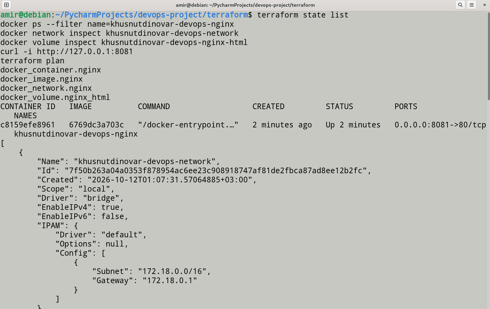
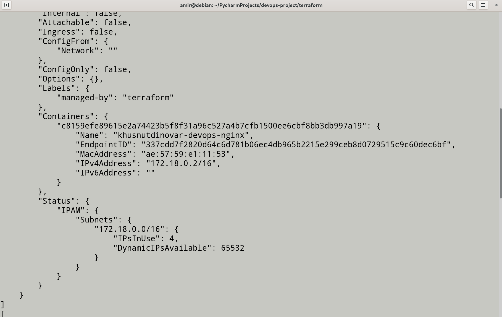
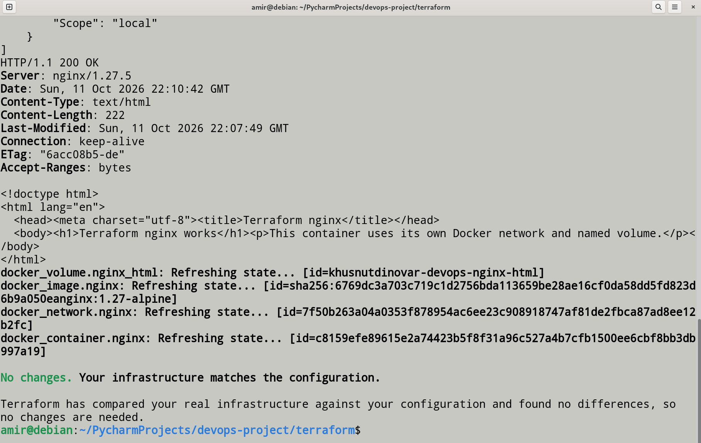
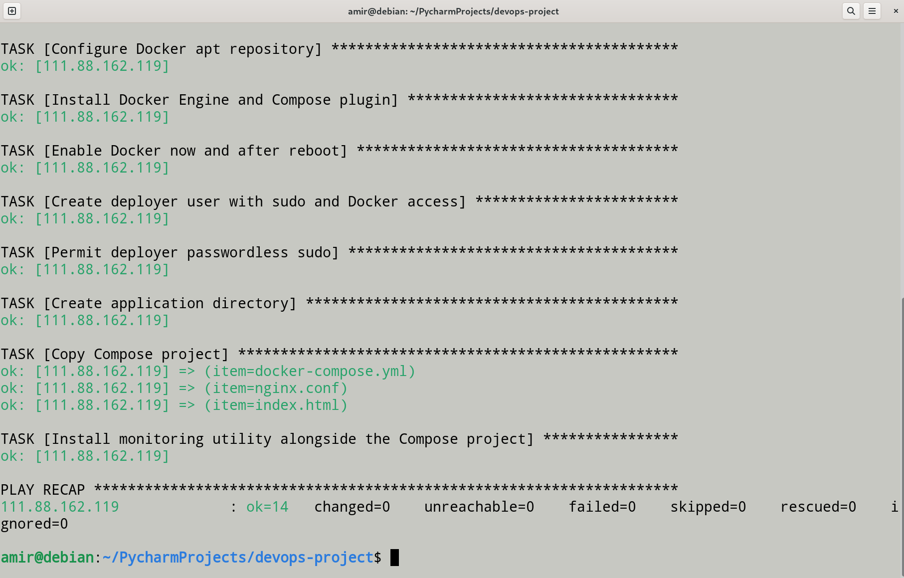
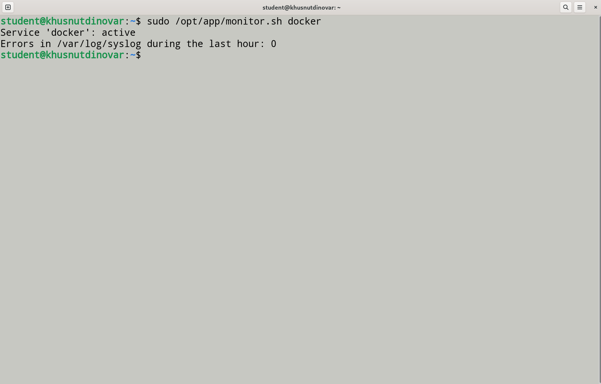
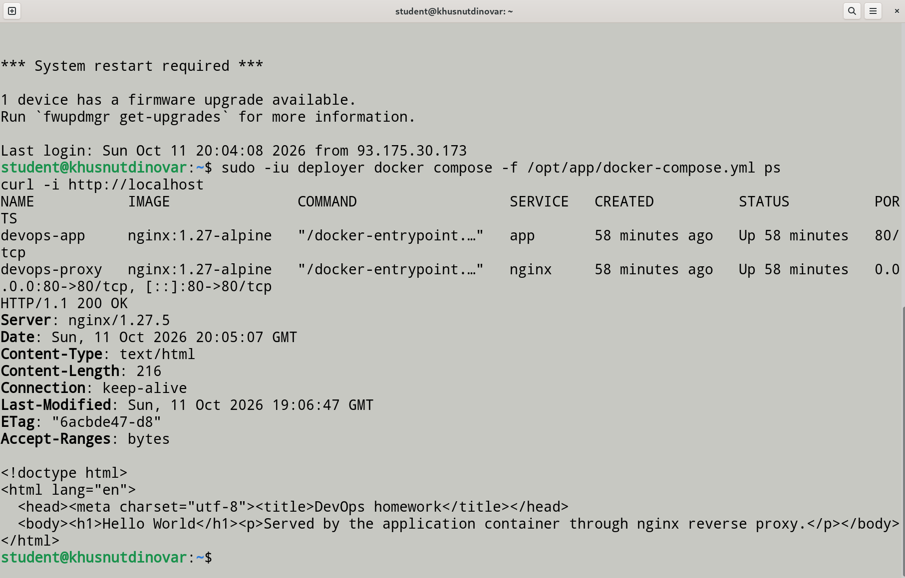
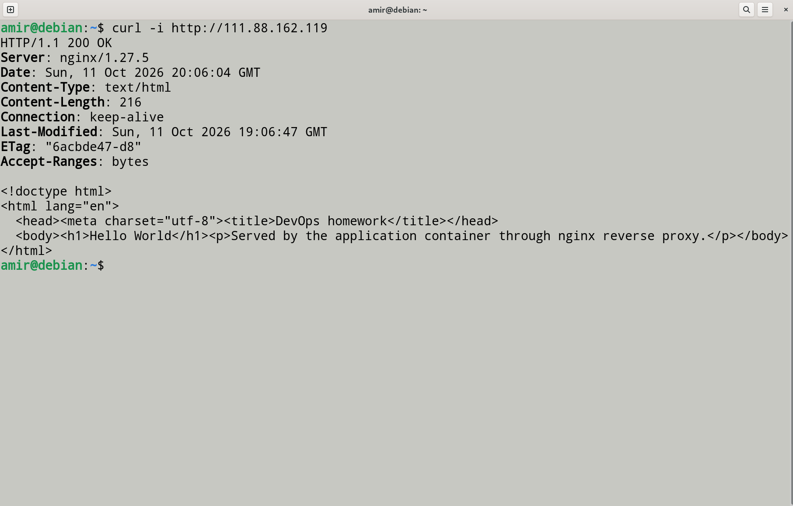

# ДЗ №1: фундамент DevOps-инфраструктуры

ДЗ №1 по DevOps Engineering — Амир Хуснутдинов (`khusnutdinovar`).

## Что сделано

- Terraform создаёт nginx-контейнер, bridge-сеть `khusnutdinovar-devops-network` и том `khusnutdinovar-devops-nginx-html`. Порт контейнера `80` опубликован на `8081`.
- Ansible устанавливает Docker Engine и Compose на VM, включает Docker при загрузке и создаёт пользователя `deployer` с sudo без пароля и доступом к Docker.
- Compose разворачивает на VM proxy nginx и внутренний nginx `app` с `Hello World`. Сервисы работают в своей сети `app_net`.
- `scripts/monitor.sh` проверяет сервис через `systemctl`, при неактивном сервисе показывает журнал и считает ошибки в syslog.

## Запуск

### Terraform

Terraform запускается на локальной машине с доступом к Docker Engine.

```bash
cd terraform
terraform init
terraform fmt -check -recursive
terraform validate
terraform plan -out=tfplan
terraform apply tfplan
curl -i http://127.0.0.1:8081
```

Если Docker-сокет недоступен текущему пользователю, один раз выполните `sudo usermod -aG docker "$USER"`, затем откройте новую сессию или выполните `newgrp docker`.

### Ansible и Compose

На управляющей машине:

```bash
ansible-galaxy collection install -r ansible/requirements.yml
cp ansible/inventory.ini.example ansible/inventory.ini
# Укажите IP VM и пользователя student в ansible/inventory.ini.
ansible-playbook -i ansible/inventory.ini ansible/setup_host.yml --ask-pass --ask-become-pass
```

Проверка на VM:

```bash
sudo -iu deployer docker compose -f /opt/app/docker-compose.yml ps
curl -i http://localhost
sudo /opt/app/monitor.sh docker
```

## Результаты проверки

### Terraform

`terraform state list` подтверждает четыре управляемых ресурса: образ, контейнер, сеть и том. Контейнер запущен и публикует `8081 -> 80`; сеть содержит только Terraform nginx.





Том создан, `curl` возвращает `HTTP/1.1 200 OK`, а повторный `terraform plan` сообщает `No changes`.



### Ansible

Повторный запуск playbook завершился без ошибок и изменений: `changed=0`.



### Мониторинг

Скрипт подтверждает активное состояние Docker и выводит число ошибок в syslog.



### Docker Compose

Оба сервиса Compose запущены; proxy опубликован на `80`, а приложение доступно через него.



Внешнее обращение к VM также возвращает `HTTP/1.1 200 OK` и страницу `Hello World`.



## Почему выбраны такие параметры

- Порт `8081` выбран специально: по условию Terraform nginx должен отвечать на нестандартном порту.
- Для Terraform nginx созданы отдельные сеть и том. Compose-сервисы находятся в другой сети `app_net` и с ним не пересекаются.
- Terraform state и рабочий `inventory.ini` не попадают в Git: state нужен Terraform для отслеживания ресурсов, а inventory содержит адрес учебной VM.
- После добавления пользователя в группу `docker` нужно открыть новую shell-сессию (`newgrp docker`), иначе Docker не даёт доступ к сокету.
- Первый запрос к nginx был сделан сразу после `terraform apply` и соединение было сброшено. После завершения запуска контейнера повторный `curl` вернул `HTTP/1.1 200 OK`.
